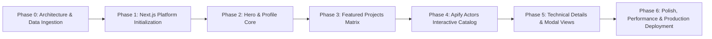

# Muhammed Faiz Seitz — Portfolio Platform Roadmap

> **Master Engineering & Delivery Roadmap**
> Target Project: Resume Next.js Platform for Muhammed Faiz Seitz
> Current Status: Foundation & Scaffolding Phase
> Last Updated: 2026-10-24

---

## Strategic Vision

Construct an industry-leading, interactive **Resume & Systems Engineering Showcase** for **Muhammed Faiz Seitz** (AI Engineer & Lead Architect, Durban South Africa). The application delivers an immersive, fast, and responsive digital resume experience that showcases full-stack web applications, game network simulations, civic intelligence architectures, and cloud automation actors.

---

## Milestones & Implementation Phases

---

### Phase 0: Project Specs & Data Extraction (COMPLETED ✅)
- [x] Ingest and catalog all 15 targeted workspace projects across `C:\Users\Faiz\Documents\workspaces\`.
- [x] Extract remote GitHub repository URLs for projects without public domains.
- [x] Discover and catalog logos, brand assets, and favicons from source directories.
- [x] Enumerate the complete suite of 37 Apify actors from `C:\Users\Faiz\Documents\workspaces\apify\`.
- [x] Sourced resume document from `\.gemini\Muhammed Faiz Seitz - Full-Stack AI Resume.pdf`.
- [x] LinkedIn profile integration established: [https://www.linkedin.com/in/muhammed-faiz-seitz/](https://www.linkedin.com/in/muhammed-faiz-seitz/).
- [x] Sourced generative AI API credentials in `.env.local` (`FAL_API_KEY` and `GEMINI_API_KEY`) for on-demand media generation.
- [x] Establish profile identity parameters (Location: Durban South Africa, Email: `byseitz.agency@gmail.com`, Avatar: `C:\Users\Faiz\Pictures\AI Engineer.png`).
- [x] Establish project source of truth in [.gemini/GEMINI.md](file:///c:/Users/Faiz/Documents/workspaces/mfseitz-portfolio/.gemini/GEMINI.md).

---

### Phase 1: Next.js Platform Initialization & Design System (COMPLETED ✅)
- [x] Initialize Next.js 15+ App Router application with TypeScript and Tailwind CSS.
- [x] Configure unified Design Tokens in `src/app/globals.css`:
  - Deep obsidian dark background palette (`#090a0f`) with glassmorphism overlays.
  - Accent neon cyan / emerald / electric violet gradients and glowing highlights.
  - Modern typography system using Geist / Inter.
- [x] Set up static data structures in [src/data/projects.ts](file:///c:/Users/Faiz/Documents/workspaces/mfseitz-portfolio/src/data/projects.ts) and [src/data/apify-actors.ts](file:///c:/Users/Faiz/Documents/workspaces/mfseitz-portfolio/src/data/apify-actors.ts) with TypeScript interfaces.
- [x] Copy and optimize avatar asset from `C:\Users\Faiz\Pictures\AI Engineer.png` into `public/images/profile.png`.
- [x] Copy and organize project logo SVGs/PNGs into `public/images/projects/`.
- [x] Mount downloadable CV asset from `\.gemini\Muhammed Faiz Seitz - Full-Stack AI Resume.pdf` into `public/Muhammed-Faiz-Seitz-Full-Stack-AI-Resume.pdf`.

---

### Phase 2: Hero Section, Personal Identity & Media Assets (COMPLETED ✅)
- [x] **Hero Presentation**:
  - High-res avatar display with animated ambient glow border.
  - Name: **Muhammed Faiz Seitz**.
  - Professional Title: *AI Engineer & Full-Stack Systems Architect*.
  - Location badge: `Durban, South Africa 🇿🇦` with SAST (UTC+2) timezone indicator.
  - Interactive "Contact Direct" email CTA and one-click copy-to-clipboard button.
  - **LinkedIn Profile Link**: Direct connection to [https://www.linkedin.com/in/muhammed-faiz-seitz/](https://www.linkedin.com/in/muhammed-faiz-seitz/).
  - **Download CV Button**: Downloadable PDF link connecting to `/Muhammed-Faiz-Seitz-Full-Stack-AI-Resume.pdf`.
- [x] **Engineering Philosophy & Bio**:
  - Metric counters: `15+ Production Systems`, `37 Apify Cloud Actors`, `11,900+ DBE Papers Ingested`, `11 SA Official Languages`.
  - Key technical stack badges (Next.js, TypeScript, Supabase, PostGIS, Apify).
- [ ] **Dynamic Media Generation Engine**:
  - Integrate `FAL_API_KEY` (fal.ai FLUX / Recraft / Kling) and `GEMINI_API_KEY` (Gemini 2.5 / Imagen 3) in Next.js API routes or generation scripts (`scripts/generate-assets.mjs`) to synthesize missing project hero banners, OpenGraph sharing cards, and stylized illustrations.

---

### Phase 3: Featured Projects Matrix (15 Core Projects) (COMPLETED ✅)
- [x] **Filterable Project Navigation**:
  - Category filters: `All`, `Civic & GovTech`, `FinTech & SaaS`, `AI & Media`, `Games & Simulations`.
  - Real-time search bar with instant filtering over project titles, tech tags, and descriptions.
- [x] **Project Cards Implementation**:
  - All 15 projects rendered with verified logos, tags, summaries, and dual action links ("Visit App" for production domains, "GitHub Repo" for codebases).

---

### Phase 4: Apify Scrapers & Cloud Agents Suite (37 Actors) (COMPLETED ✅)
- [x] Build interactive grid for all 37 Apify actors.
- [x] Category filtering: `Intelligence & News`, `Market & Real Estate`, `Media, RAG & LLM`, `GovTech & Local Data`.
- [x] Real-time keyword & tag search for quick discovery.

---

### Phase 5: Deep-Dive Technical Drawer / Modal (COMPLETED ✅)
- [x] Built [ProjectModal.tsx](file:///c:/Users/Faiz/Documents/workspaces/mfseitz-portfolio/src/components/ProjectModal.tsx) for in-depth inspection without leaving the page.
- [x] Displays architectural highlights, engineered stack breakdown (Frontend, Backend, Database, Styling), and direct repository links.

---

### Phase 6: Performance, SEO, Dynamic Media & Deployment
- [ ] Implement OpenGraph meta tags, Twitter card tags, and JSON-LD schema for SEO utilizing Gemini & Fal generated preview cards.
- [ ] Connect LinkedIn badge and verifiable credentials into the footer and contact sections.
- [ ] Responsive testing across Mobile, Tablet, and Ultra-wide Desktop viewports.
- [ ] Fast load times: Next.js image optimization, SVGs, and minimal initial bundle size.
- [ ] Configure automated GitHub Actions CI/CD pipeline for Vercel deployment.
- [ ] Verify live domain / preview environment connectivity.
